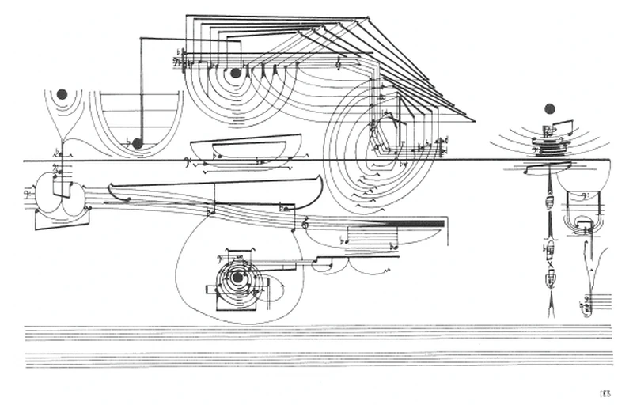

# Cardew
A graph interface for exploring data and creating interactive scores. Distributed as an Obsidian Plugin.




The name is inspired by Cornelius Cardew's graphical scores.

## How to use

In Obsidian, create a new Vault (see [Obsidian Docs](https://obsidian.md/)). Clone the reposityory inside the vault's folder at ```vault-name/.obsidian/plugins```.
In Obsidian's setting allow for external plugin and enable Cardew.

Extended documentation can be found at [Cardew Docs](https://mauriziobrt.github.io/Cardew)

## Build Documentation

1. Create Python envrionment
2. Activate Python environment
3. python -m pip install sphinx pydata-sphinx-theme myst-parser sphinx-autobuild
4. python -m sphinx -b html docs docs/_build/html OR python -m sphinx_autobuild docs docs/_build/html


## Roadmap

| **Features** | **Release** | **Status** |
|-|-| -|
| **Send continuous position of Node through OSC (toggle)** | October 2026 | |
| **Custom node shapes and colours depending on class-dependent custom metadata properties** | October 2026 | |
| **Export** | October 2026 | |
| **Edit Link Directionality** | October 2026 | |
| **Graph commands using Obsidian's hotkeys** | October 2026 | |
| **Stats View**  | October 2026 | |
| **Transition Interaction Re-implementation**  | October 2026 | |
| **Cluster Nodes**  | November 2026 | |
| **Link Interaction**  | November 2026 | |
| **Examples in Docs**  | November 2026 | *Development* |

## Known Bugs and Fixes

- [ ] The rectangle selection is not always working that well. (sometimes it’s not working until I use some other command) → it seems to be linked also to the physics of the system
- [ ] The canvas has a scrollbar and it shouldn’t
- [ ] Remove full pass of graph to objects and only pass what is needed
- [ ] When not clicking and not hovering a node the mouse pointer should be regular pointer
- [ ] When saving also save the current config
- [ ] Disable drag when fx and fy are not empty (or just add a disable drag or enabled drag checkbox)
- [ ] Editing class with multiple selected items doesn’t edit all of their classes
- [ ] If multiple selected items and I edit property, apply to all of them
- [ ] Cmd + i should not be active on the canvas but in general on the app, so at the actions level
- [ ] When I add a property there should be some typescript place that sees it as what it is so it’s not undefined, like add the id: string to NodeObject somehow
- [ ] When creating a new node, option to start from zero or keeping the last edited node’s class. Config, new node behavior menu keep last or no, also copy paste of single nodes.


## Cite

Please cite our work if you use it:

*Maurizio Berta, Roberto Bresin, and Gaël Dubus. 2026. Can sonification aid the perception of complex visual networked data? A tool for the interactive exploration of bibliometric data. In Proceedings of the 2026 International Conference on Advanced Visual Interfaces (AVI '26). Association for Computing Machinery, New York, NY, USA, Article 39, 1–9. [https://doi.org/10.1145/3811427.3811439](https://doi.org/10.1145/3811427.3811439)*
