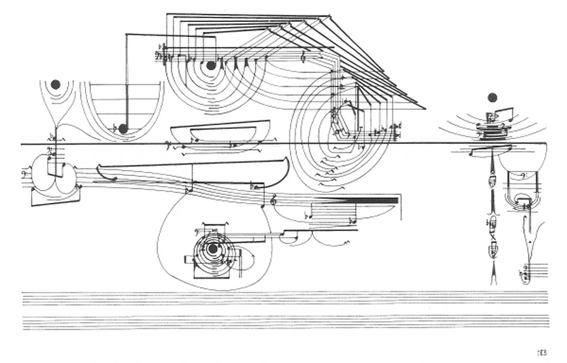

# Cardew
A graph interface for exploring data and creating interactive scores. Distributed as an Obsidian Plugin.




The name is inspired by Cornelius Cardew's graphical scores.

## How to use

In Obsidian, create a new Vault (see [Obsidian Docs](https://obsidian.md/)). Clone the reposityory inside the vault's folder at ```vault-name/.obsidian/plugins```.
In Obsidian's setting allow for external plugin and enable Cardew.

Inside the folder: npm install and npm run dev.

Extended documentation can be found at [Cardew Docs](https://mauriziobrt.github.io/Cardew)

## Build Documentation

1. Create Python envrionment
2. Activate Python environment
3. python -m pip install sphinx pydata-sphinx-theme myst-parser sphinx-autobuild
4. python -m sphinx -b html docs docs/_build/html OR python -m sphinx_autobuild docs docs/_build/html


## Roadmap

| **Features** | **Release** | **Status** |
|-|-| -|
| **Custom node shapes and colours depending on class-dependent custom metadata properties** | October 2026 | X |
| **Edit Link Directionality** | October 2026 | X |
| **Graph commands using Obsidian's hotkeys** | October 2026 | X |
| **Send continuous position of Node through OSC (toggle)** | October 2026 | X |
| **Export** | November 2026 | |
| **Stats View**  | November 2026 | |
| **Transition Interaction Re-implementation**  | November 2026 | |
| **Cluster Nodes**  | November 2026 | |
| **Link Interaction**  | November 2026 | |
| **Examples in Docs**  | November 2026 | *Development* |

## Known Bugs and Fixes

- [ ] The canvas has a scrollbar and it shouldn’t
- [ ] Remove full pass of graph to objects and only pass what is needed
- [ ] When not clicking and not hovering a node the mouse pointer should be regular pointer
- [ ] When creating a new node, option to start from zero or keeping the last edited node’s class. Config, new node behavior menu keep last or no, also copy paste of single nodes.

Checking tsc errors: npx tsc --noEmit > errors.txt
Use correct node version nvm use node

## Cite

Please cite our work if you use it:

*Maurizio Berta, Roberto Bresin, and Gaël Dubus. 2026. Can sonification aid the perception of complex visual networked data? A tool for the interactive exploration of bibliometric data. In Proceedings of the 2026 International Conference on Advanced Visual Interfaces (AVI '26). Association for Computing Machinery, New York, NY, USA, Article 39, 1–9. [https://doi.org/10.1145/3811427.3811439](https://doi.org/10.1145/3811427.3811439)*
