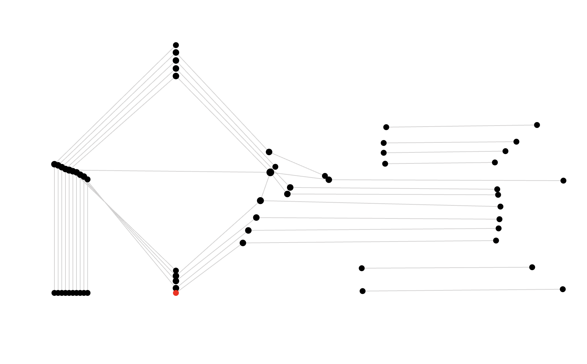
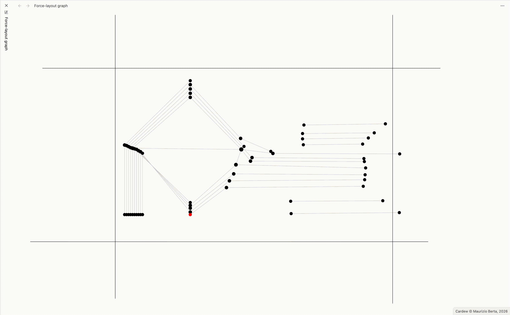

# Writing Scores

## Static Scores

<figure>
    
    <figcaption>Cornelius Cardew - Treatise page 18 recreated in Cardew.</figcaption>
</figure>

The score can be played interactively (see {doc}`../getting-started/controls/interaction-modes`) or using the axes reading it from any direction. 

<figure>
    
    <figcaption>Cornelius Cardew - Treatise page 18 recreated in Cardew.</figcaption>
</figure>