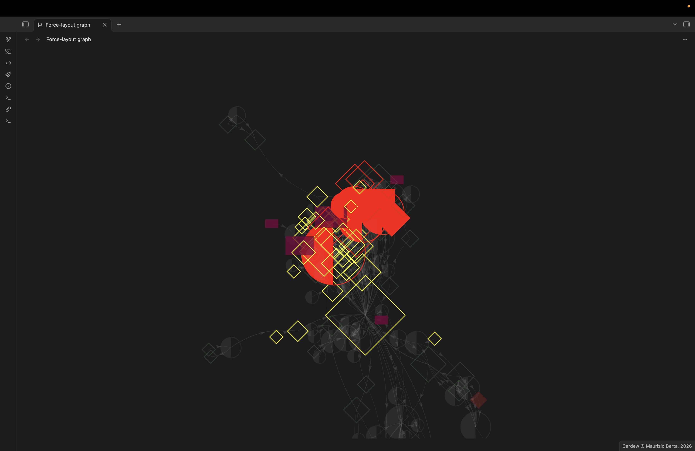
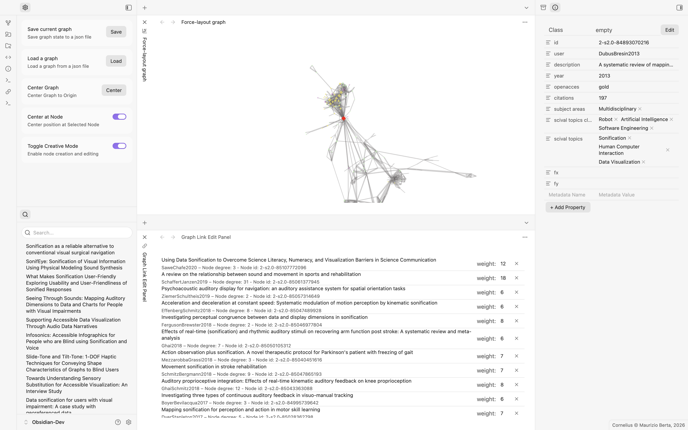

# Getting Started

<figure>
    
    <figcaption>The graph loaded with a co-citaton coupling graph and custom node shapes.</figcaption>
</figure>

When opening Cardew for the first time you'll see a force graph network of bibliometric data opening up. All of the panels will be visible to the user. The panels can be dinamycally moved and closed. 

By default they are organised as follows:

- Left side panel:
    - Top: **quick settings** and actions (save, load, display directional arrows)
    - Bottom: **filter** and search nodes by properties (only work with string properties)
- Center panel:
    - Top: the **Force-layout Graph**, where users can edit and explore the data
    - Bottom: the **Graph Link Edit Panel**. When a node is selected users can see all of its connections and add new ones
- Right panel: **Metadata Edit Panel**. When a node is selected users can edit its properties. If multiple nodes are selected users can change their classes.




```{toctree}
:maxdepth: 2
:caption: Interaction and Control

getting-started/controls/selecting-nodes
getting-started/controls/interaction-modes
getting-started/controls/filtering
getting-started/controls/osc
```

```{toctree}
:maxdepth: 2
:caption: Editing Data

getting-started/editing/creating
getting-started/editing/metadata
getting-started/editing/link-edit
getting-started/editing/shape-edit
```

```{toctree}
:maxdepth: 2
:caption: Settings

getting-started/settings/quick-settings
getting-started/settings/settings
```