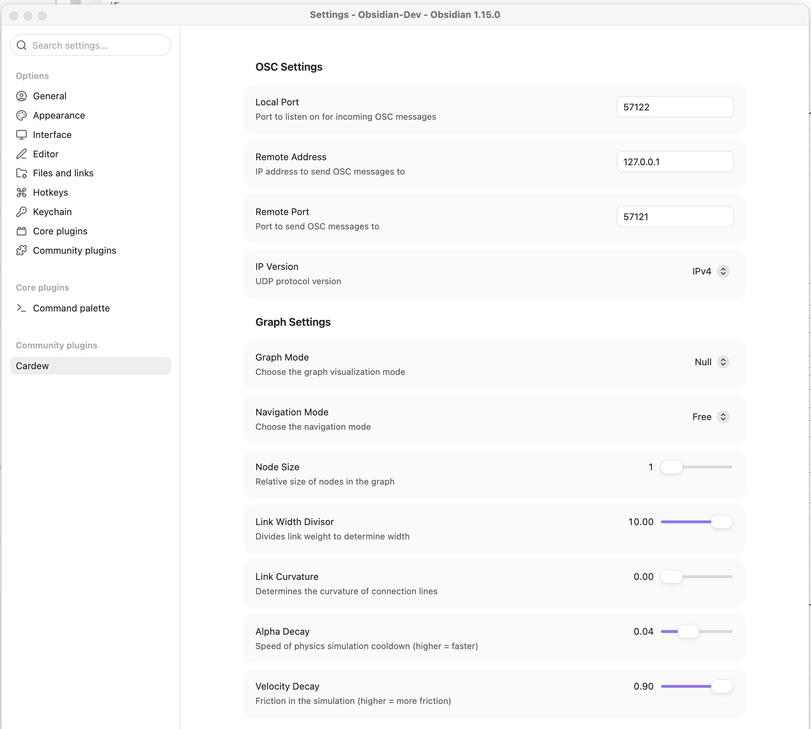
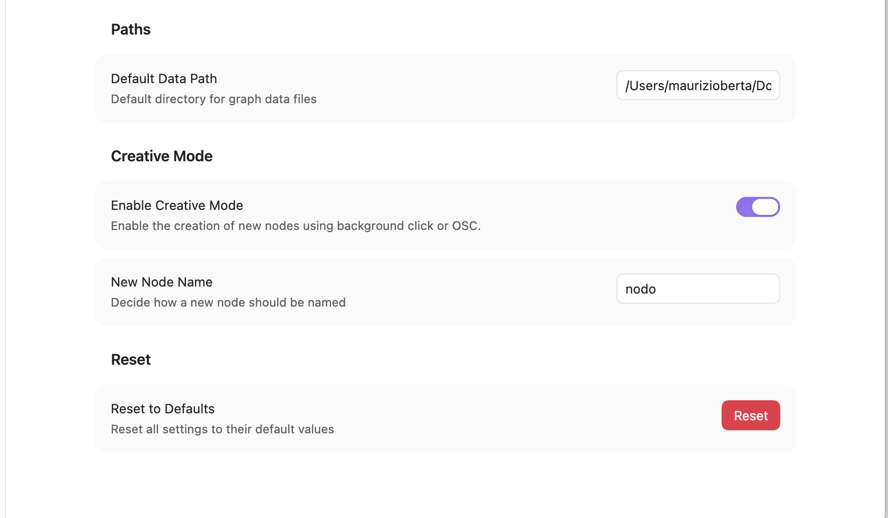

# Settings

<figure>
    
    <figcaption>The graph loaded with the physics example.</figcaption>
</figure>

<figure>
    
    <figcaption>The graph loaded with the physics example.</figcaption>
</figure>